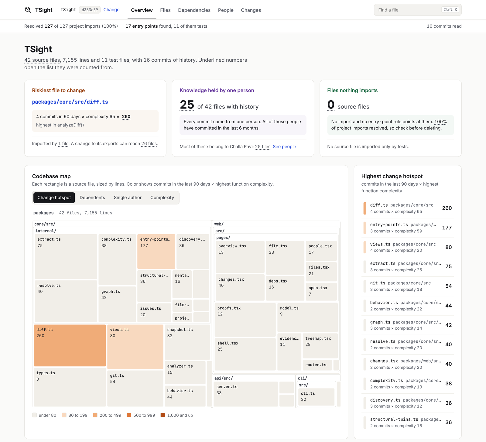

# TSight

Understand any TypeScript codebase in 30 seconds.
No AI. No guessing. Just facts from your code.

TSight reads a TypeScript or JavaScript project and its git history and shows you how it fits together: which files everything depends on, what breaks if you change something, who has worked on what, and where the tangled parts are. It runs on your machine and your code stays there.



## Quick start

You need Node.js 20 or newer.

Mac or Linux:

```bash
./start.sh
```

Windows: double-click `start.bat`.

The browser opens at http://localhost:3000. Click Analyze and give it the path to a project folder.

## What it shows

Every number can be traced back to your code. This is how each one is worked out.

**Imports.** TSight resolves imports the way the TypeScript compiler does, using the nearest `tsconfig.json` for each file. That covers path aliases like `@/lib/utils`, ESM imports written as `./file.js`, re-exports, `import()` and `require()`. Workspace packages in a monorepo are matched to their source folders. The overview tells you how many project imports it could resolve. If some couldn't be found, it says so, because those links are missing from everything below.

**Dependents and blast radius.** The files that import a file directly, and then the files that import those, and so on. Type-only imports are included, since changing a type can break the code that uses it.

**Hotspots.** Files that are complex and imported by many other files. The score is the file's total cyclomatic complexity times the number of source files that import it. For example, complexity 18 and 34 dependents gives 612.

**Complexity.** Standard cyclomatic complexity: 1, plus 1 for each `if`, `?:`, loop, `case`, `catch`, `&&`, `||` and `??`. Every function, method, constructor and named arrow function gets its own score. An inline callback, like the one you pass to `map` or `useEffect`, counts toward the function it sits in. One at the top level of a file, like `forwardRef(...)` or a route handler, is scored on its own.

**Cycles.** Groups of files that import each other in a loop, found with a strongly connected components search. Type-only imports and `import()` calls are left out, because they can't cause load-order problems at runtime.

**Duplicate files.** Files with the same code once whitespace and comments are ignored. Each group says whether the files are also identical byte for byte.

**Which files are analyzed.** In a git repository, the files git tracks plus new files that aren't ignored, exactly as `git ls-files` lists them. Outside git, every file except those in `.gitignore` and common build folders such as `dist` and `node_modules`.

**Structural twins.** Functions whose syntax is the same once you ignore variable names and literal values. These are usually copies. Each pair says whether the names and values match too.

**Files with no importers.** Source files that nothing imports and that no entry-point rule covers. Entry points come from `package.json` (`main`, `exports`, `bin` and scripts), `<script>` tags in HTML files, Next.js file conventions, tool config files and test files. TSight says "no importers found", not "unused", because a file can still be loaded in a way it can't see.

**Git history.** Churn, ownership, bus factor and knowledge gaps, read from your local `.git` folder. No token or network access is needed. Names go through `.mailmap`, renamed files keep their history, and merge commits are skipped. If you analyze a subfolder, history is matched to that folder.

## What it doesn't do

- It doesn't guess what a file is for from its name. Folders are shown as folders.
- It doesn't produce a single health grade. You get the counts behind it instead.
- It doesn't send your code anywhere.
- It reads code, it doesn't run it. Anything decided at runtime, such as `import(someVariable)`, isn't followed.

## Docker

```bash
docker build -t tsight .
docker run -p 127.0.0.1:3000:3000 -v "/path/to/your/code:/code" tsight
```

Open http://localhost:3000 and enter a path under `/code`, for example `/code/my-project`.

The command above only lets your own computer reach TSight. There is no login, so anyone who can reach it can read the analysis of everything under `/code`. If you still want to open it from another machine, publish the port with `-p 3000:3000` and add that machine's address for your server with `-e TSIGHT_ALLOWED_HOSTS=192.168.1.20`.

## Running it from source

```bash
npm install
npm run build
npm test
```

During development, `npm run dev` starts the API on port 3001 and the web UI on port 3000.

To check the numbers against three real repositories pinned to exact commits, run `TSIGHT_CORPUS=1 npm test`. It clones about 150 MB the first time, so it isn't part of the normal test run.

The code is split into three packages:

- `packages/core`: the analysis engine. Everything that produces a number lives here, with tests in `packages/core/test`.
- `packages/api`: a small Express server that calls core.
- `packages/web`: the React UI.

## Contributing

Issues and pull requests are welcome. If you change how a number is calculated, add a test in `packages/core/test` that shows the case it fixes.

## License

MIT
